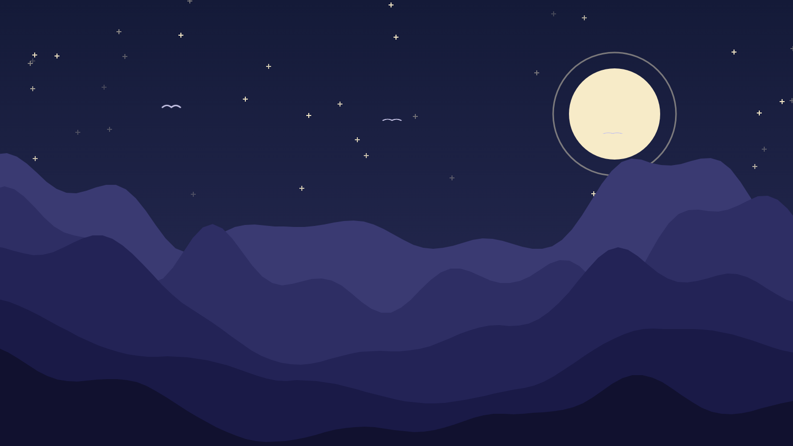

# Papercut Peaks Night

The paper-cut mountains at night: layers of indigo paper under a paper moon, with cut-out stars that twinkle and birds gliding by. Its day twin is `papercut-peaks`.

It is a dark theme and keeps the app dark. The panels are frosted over the scene so text stays readable. Animations stop if your system asks for reduced motion.

Install: `/plugin install papercut-peaks-night --marketplace PerspicaciousGuy/ClaudeCodeThemes` (see the [repository README](../../README.md#install) for the desktop app and shell steps).
