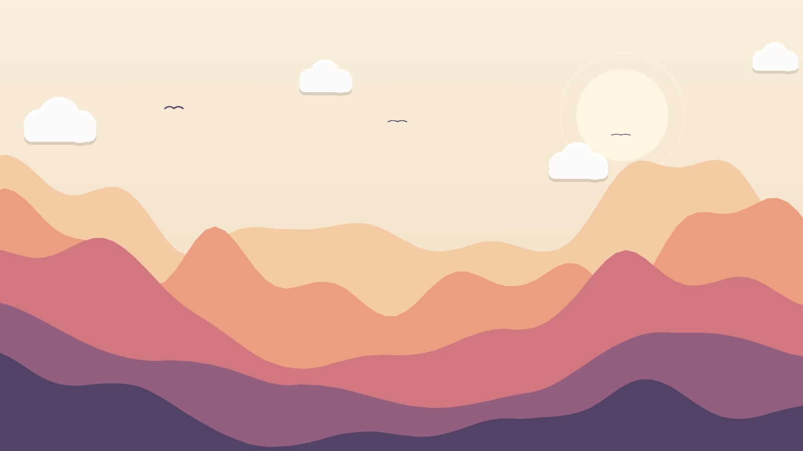

# Papercut Peaks

A paper-cut landscape: five sheets of colored paper, each casting a soft shadow on the one behind, drifting a little against each other. Paper clouds float by and birds glide across. The valley dips under the chat. Its night twin is `papercut-peaks-night`.

It is a light theme and keeps the app light. The panels are frosted over the scene so text stays readable. Animations stop if your system asks for reduced motion.

Install: `/plugin install papercut-peaks --marketplace PerspicaciousGuy/ClaudeCodeThemes` (see the [repository README](../../README.md#install) for the desktop app and shell steps).
