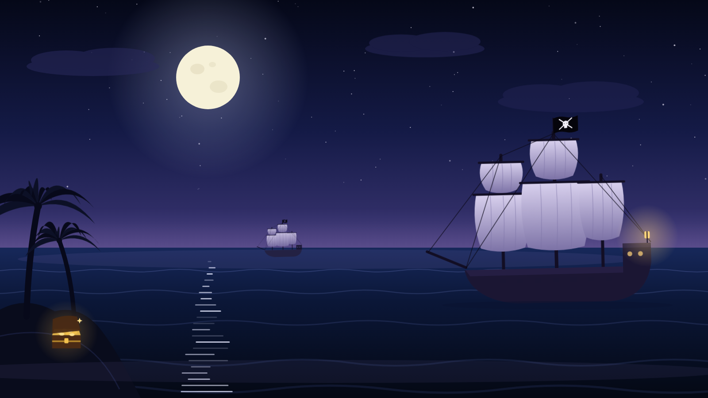

# Pirate Cove Night

The night twin of `pirate-cove`. A galleon sails under a full moon: its skull flag waves, a lantern burns at the stern and the ship rocks on the swell. A far ship crosses the horizon, moonlight glitters on the water and a treasure chest glows on a palm islet at the edge. The middle is open sea so the chat stays clear.

It is a dark theme and keeps the app dark. The panels are frosted over the scene so text stays readable. Animations stop if your system asks for reduced motion.

Install: `/plugin install {ID} --marketplace PerspicaciousGuy/ClaudeCodeThemes` (see the [repository README](../../README.md#install) for the desktop app and shell steps).
