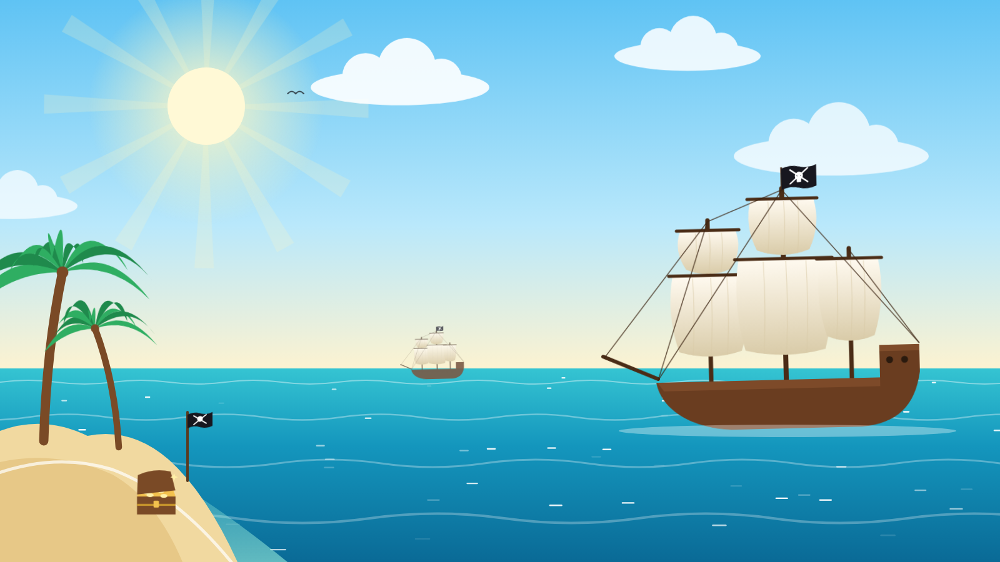

# Pirate Cove

A pirate galleon at anchor in a sunny turquoise cove. Its skull flag waves and the ship rocks on the swell, gulls cross the sky, sunlight sparkles on the water and a far sail sits on the horizon. At the edge a palm beach holds a pirate flag and an open treasure chest. The middle is open sea so the chat stays clear. The night twin is `pirate-cove-night`.

It is a light theme and keeps the app light. The panels are frosted over the scene so text stays readable. Animations stop if your system asks for reduced motion.

Install: `/plugin install {ID} --marketplace PerspicaciousGuy/ClaudeCodeThemes` (see the [repository README](../../README.md#install) for the desktop app and shell steps).
