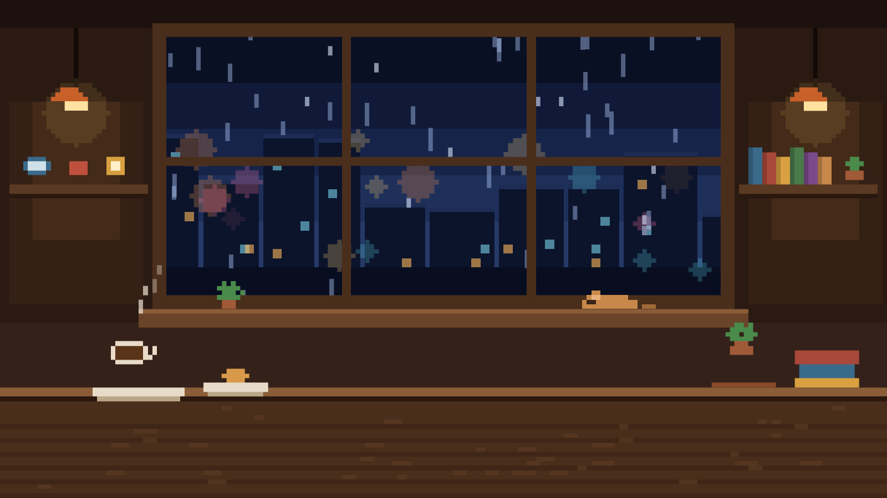

# Pixel Cafe

Rain runs down a big window over the blurred lights of a night street. Two pendant lamps glow warm, a cup steams on the wooden counter, mugs and books sit on the side shelves and a cat sleeps on the sill. The window is the soft middle of the frame, so the chat stays readable.

It is a dark theme and keeps the app dark. The panels are frosted over the scene so text stays readable. Animations stop if your system asks for reduced motion.

Install: `/plugin install pixel-cafe --marketplace PerspicaciousGuy/ClaudeCodeThemes` (see the [repository README](../../README.md#install) for the desktop app and shell steps).
