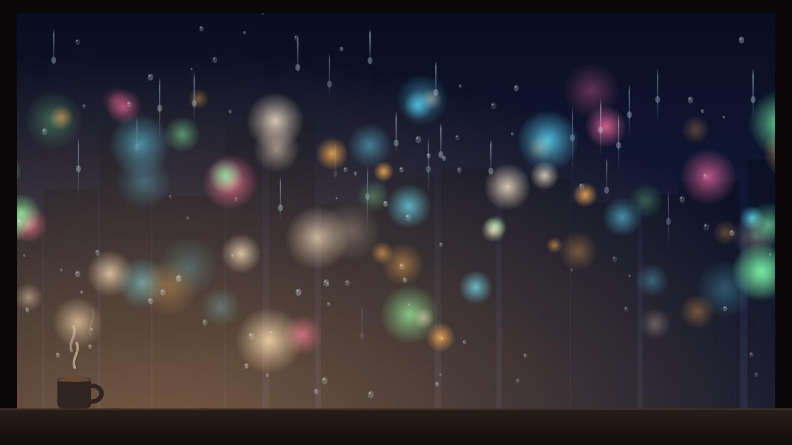

# Rainy Window

A night city through a rain-streaked window. Out-of-focus lights pulse, drops slide down the glass, tail lights cross far below, and a mug steams on the sill in warm lamplight.

It is a dark theme and keeps the app dark. The panels are frosted over the scene so text stays readable. Animations stop if your system asks for reduced motion.

Install: `/plugin install rainy-window --marketplace PerspicaciousGuy/ClaudeCodeThemes` (see the [repository README](../../README.md#install) for the desktop app and shell steps).
