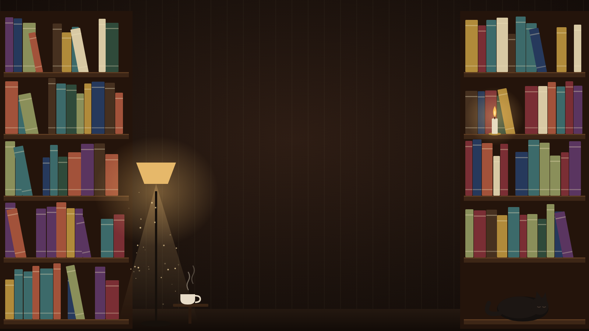

# Reading Room

A cozy library at night. Tall shelves of books fill both sides, a floor lamp throws a cone of warm light with dust turning in it, a candle flickers on a shelf, a cup of tea steams on a small table and a cat sleeps on the lowest shelf. The middle is plain wall for the chat.

It is a dark theme and keeps the app dark. The panels are frosted over the scene so text stays readable. Animations stop if your system asks for reduced motion.

Install: `/plugin install reading-room --marketplace PerspicaciousGuy/ClaudeCodeThemes` (see the [repository README](../../README.md#install) for the desktop app and shell steps).
