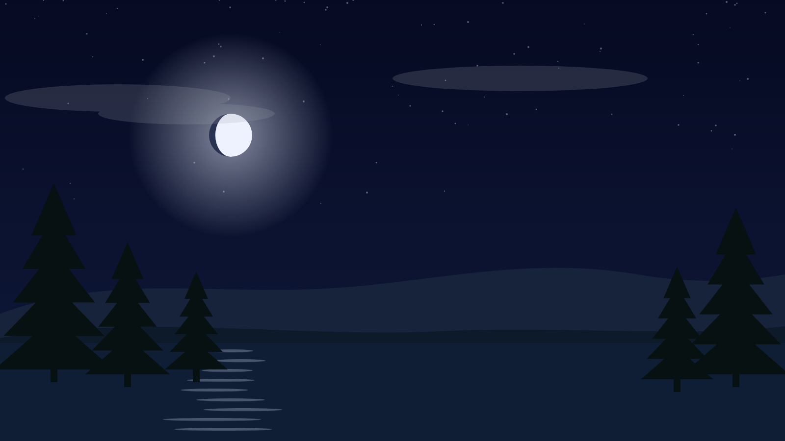

# Real Sky

A lakeside view under the sky outside right now.

- **The sun follows your clock.** It rises at 6:00, crosses the sky and sets at 18:00, and the sky changes color through dawn, day, dusk and night in half-hour steps.
- **The moon follows the calendar.** At night it crosses in its real phase for today's date, from a thin crescent to full, with stars and its reflection in the lake.
- It needs no subscription or network: it uses only your clock and the date.

It is a dark theme and keeps the app dark. The panels are frosted over the scene so text stays readable. Animations stop if your system asks for reduced motion.

## Use it

Install: `/plugin install real-sky --marketplace PerspicaciousGuy/ClaudeCodeThemes` (see the [repository README](../../README.md#install) for the desktop app and shell steps).

Run `/realsky` to put the look on. If you also use `theme-library` or another live theme, whichever theme was set last wins, so run `/realsky` whenever you want this one back.

| Command | What it does |
| --- | --- |
| `/realsky` or `/realsky auto` | Apply the look and follow your clock. |
| `/realsky 0` to `/realsky 23` | Show an hour to see it, until `/realsky auto`. |

The status line shows what it is reading, for example `sky: 21:30, waxing gibbous`.

## Why it is a separate plugin

Every other theme is a fixed scene, so they live together in `theme-library`. This one redraws as your session changes, so it is its own plugin and is not part of the library picker. The picture above is one moment of it.
