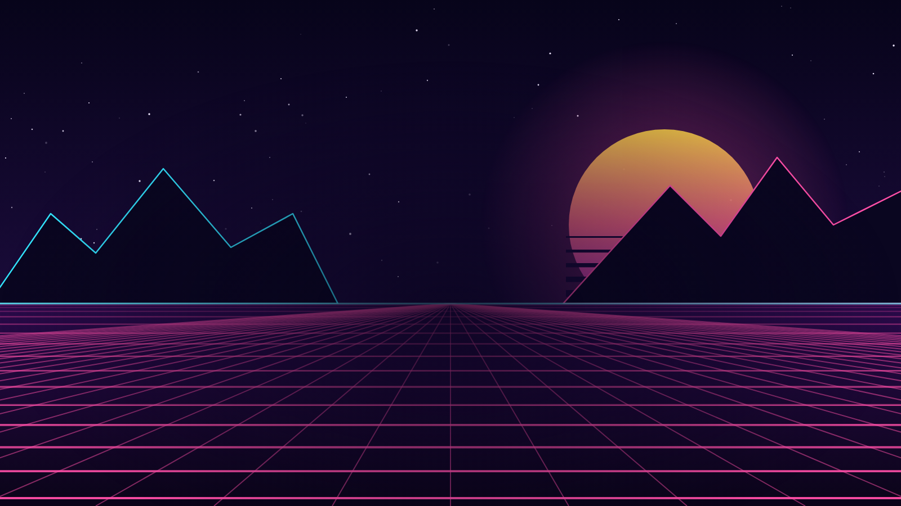

# Retro Grid

A neon horizon. A slatted sun glows behind wireframe mountains while a perspective grid rolls toward you, a scan line crosses the horizon and the stars twinkle. A dark veil rests the middle for the chat.

It is a dark theme and keeps the app dark. The panels are frosted over the scene so text stays readable. Animations stop if your system asks for reduced motion.

Install: `/plugin install retro-grid --marketplace PerspicaciousGuy/ClaudeCodeThemes` (see the [repository README](../../README.md#install) for the desktop app and shell steps).
