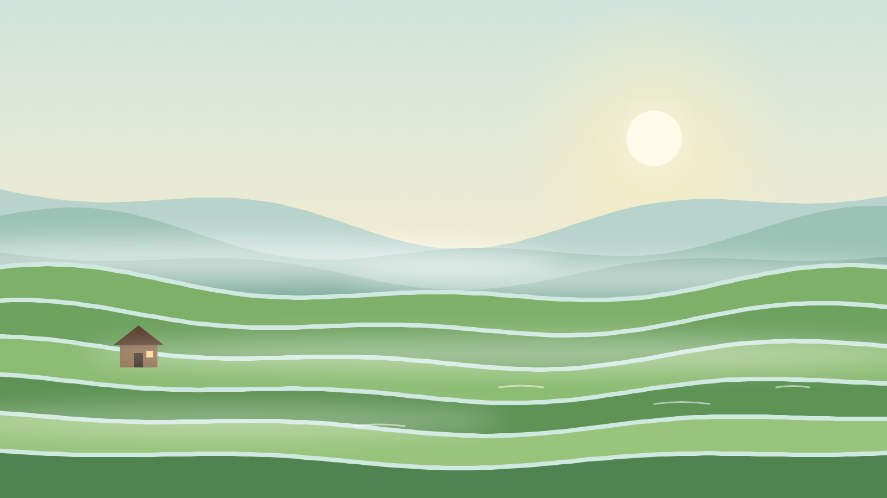

# Rice Terraces

A misty morning over rice terraces. Pale mountains rise behind a low sun, curved green steps alternate with strips of sky-colored water, a small hut sits on one step, banks of mist drift between the terraces and egrets cross the sky.

It is a light theme and keeps the app light. The panels are frosted over the scene so text stays readable. Animations stop if your system asks for reduced motion.

Install: `/plugin install rice-terraces --marketplace PerspicaciousGuy/ClaudeCodeThemes` (see the [repository README](../../README.md#install) for the desktop app and shell steps).
