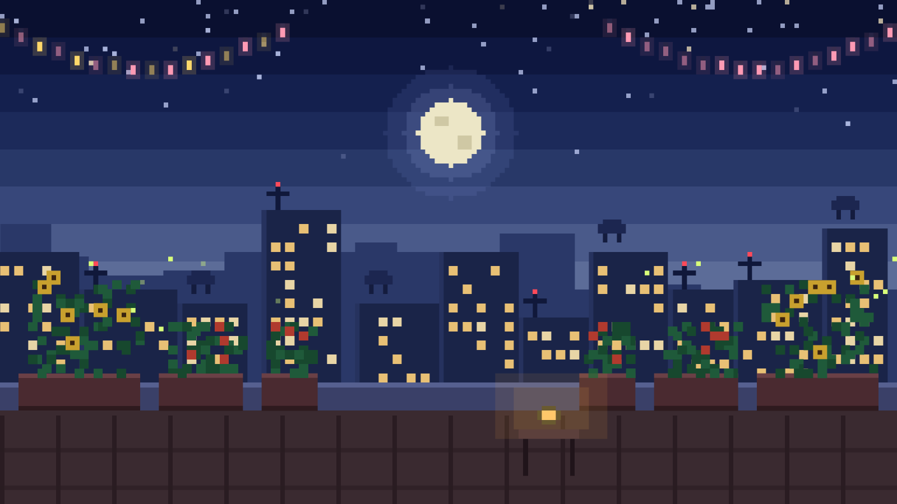

# Rooftop Garden Night

The night twin of `rooftop-garden`. A deep-blue sky with a moon and stars sits over a skyline full of lit windows, string lights glow along the top corners, fireflies drift above the planters and a lantern burns on the table.

It is a dark theme and keeps the app dark. The panels are frosted over the scene so text stays readable. Animations stop if your system asks for reduced motion.

Install: `/plugin install rooftop-garden-night --marketplace PerspicaciousGuy/ClaudeCodeThemes` (see the [repository README](../../README.md#install) for the desktop app and shell steps).
