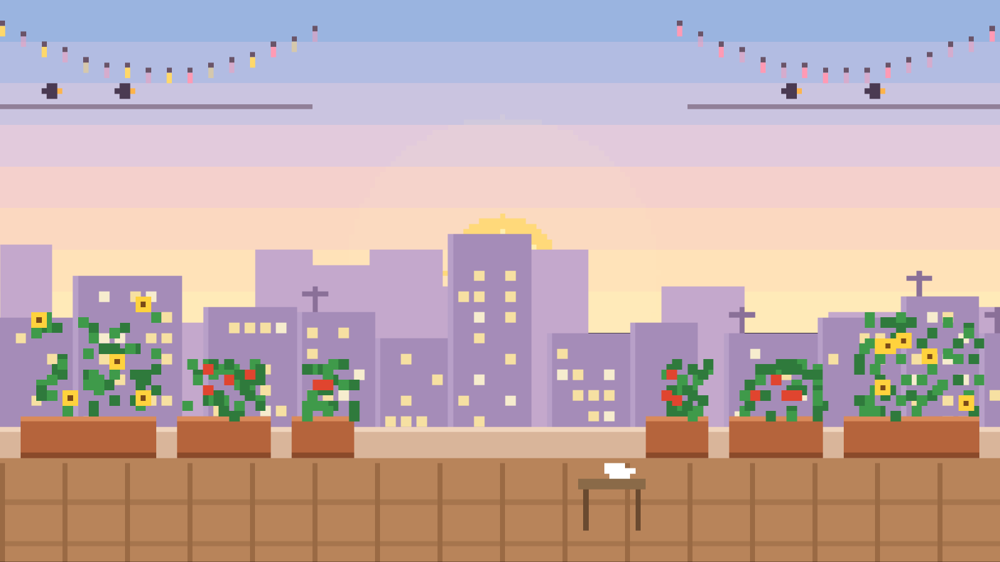

# Rooftop Garden

A pixel-art rooftop at golden hour. A pastel skyline with lit windows glows behind the parapet, planters of sunflowers and tomatoes sway in the breeze, string lights twinkle from the corners, birds sit on a wire and a kite drifts across the sky.

It is a light theme and keeps the app light. The panels are frosted over the scene so text stays readable. Animations stop if your system asks for reduced motion.

Install: `/plugin install rooftop-garden --marketplace PerspicaciousGuy/ClaudeCodeThemes` (see the [repository README](../../README.md#install) for the desktop app and shell steps).
