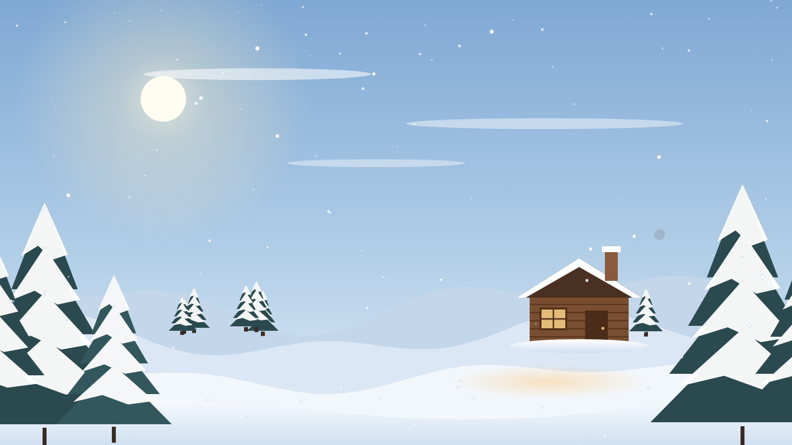

# Snow Cabin Day

The day twin of `snow-cabin`. A pale blue sky with a low winter sun over white hills, a log cabin whose window still glows, smoke curling from its chimney, glints on the snow and flakes falling in three layers past snow-laden pines.

It is a light theme and keeps the app light. The panels are frosted over the scene so text stays readable. Animations stop if your system asks for reduced motion.

Install: `/plugin install snow-cabin-day --marketplace PerspicaciousGuy/ClaudeCodeThemes` (see the [repository README](../../README.md#install) for the desktop app and shell steps).
