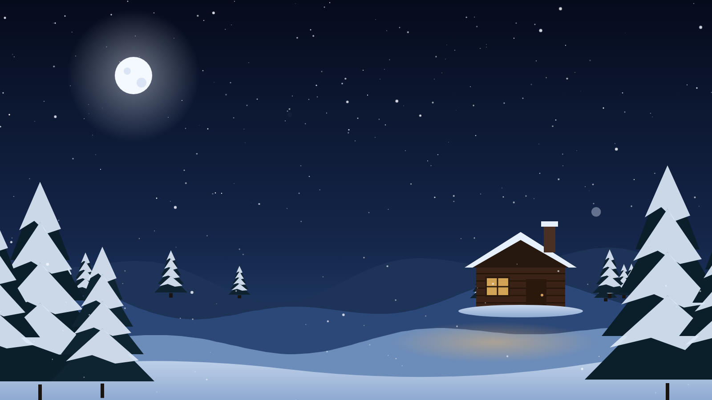

# Snow Cabin

A winter night. A log cabin with a flickering lit window sits on the snow at the right, smoke curls from its chimney, a moon hangs over the hills and snow falls in three layers, with snow-laden pines at the edges.

It is a dark theme and keeps the app dark. The panels are frosted over the scene so text stays readable. Animations stop if your system asks for reduced motion.

Install: `/plugin install snow-cabin --marketplace PerspicaciousGuy/ClaudeCodeThemes` (see the [repository README](../../README.md#install) for the desktop app and shell steps).
