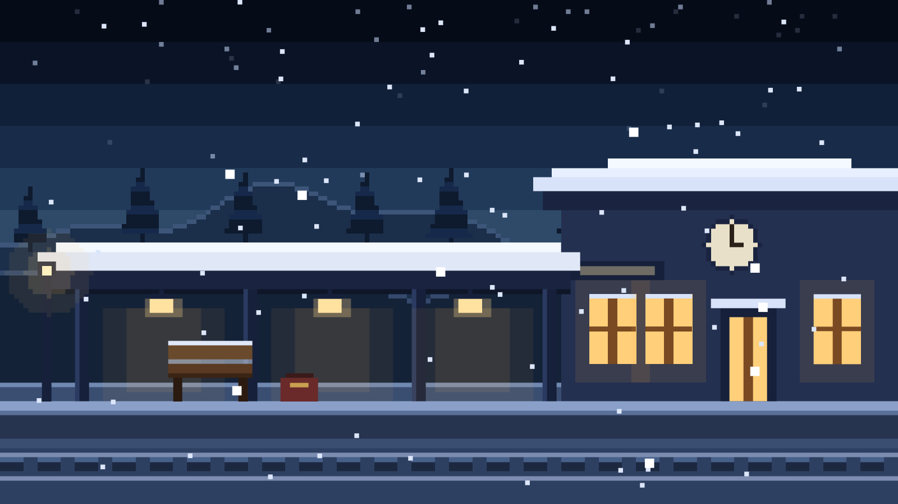

# Snow Station

Snow drifts down past the warm lamps under a platform canopy. A night train with lit windows crosses the far track, the station clock glows on its gable, and a bench and a suitcase wait on the platform. The middle of the frame is open snow and sky for the chat.

It is a dark theme and keeps the app dark. The panels are frosted over the scene so text stays readable. Animations stop if your system asks for reduced motion.

Install: `/plugin install snow-station --marketplace PerspicaciousGuy/ClaudeCodeThemes` (see the [repository README](../../README.md#install) for the desktop app and shell steps).
