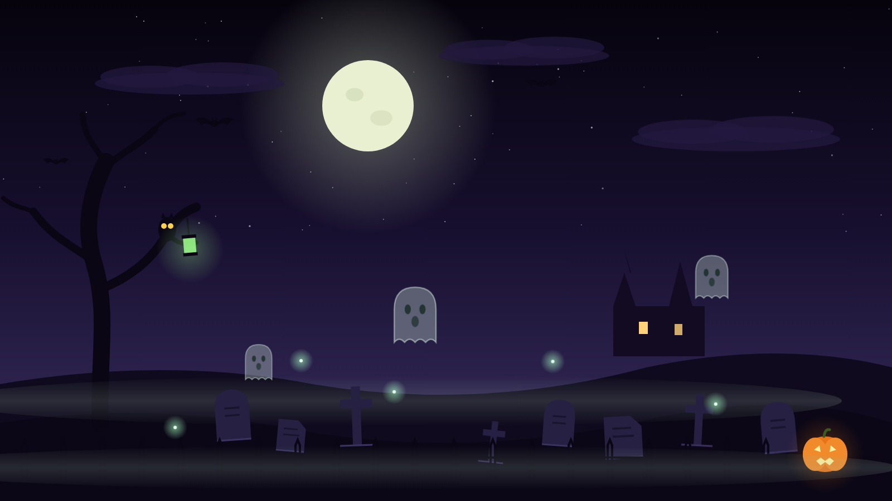

# Spooky Hollow

A haunted graveyard on a moonlit night. A dead tree on the left holds a swinging green lantern and an owl that blinks now and then. Tilted tombstones and an iron fence stand in drifting fog, three ghosts float and sway, green wisps wander, bats flap across the sky, a crooked house flickers in one window and a pumpkin glows at the right. The middle stays clear for the chat.

It is a dark theme. The panels are frosted over the scene so text stays readable. Animations stop if your system asks for reduced motion.

Install: `/plugin install {ID} --marketplace PerspicaciousGuy/ClaudeCodeThemes` (see the [repository README](../../README.md#install) for the desktop app and shell steps).
