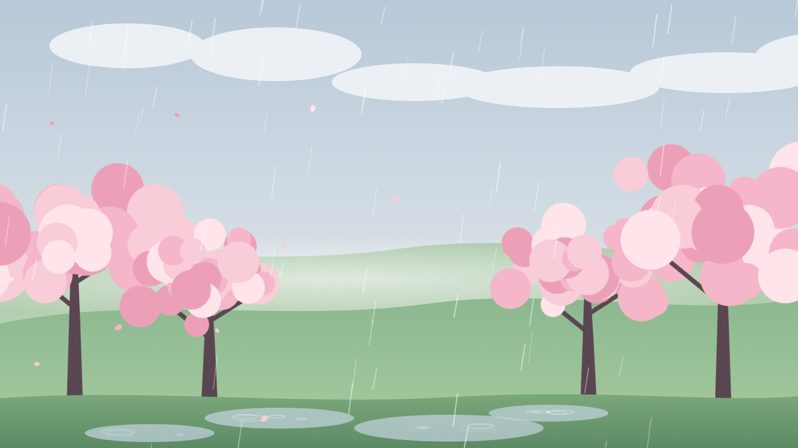

# Spring Rain

A soft rain falls over pale hills. Blossoming trees at the sides shed petals, puddles ripple in the grass, slow clouds drift and mist lies in the valleys. The middle stays open and calm for the chat.

It is a light theme and keeps the app light. The panels are frosted over the scene so text stays readable. Animations stop if your system asks for reduced motion.

Install: `/plugin install spring-rain --marketplace PerspicaciousGuy/ClaudeCodeThemes` (see the [repository README](../../README.md#install) for the desktop app and shell steps).
