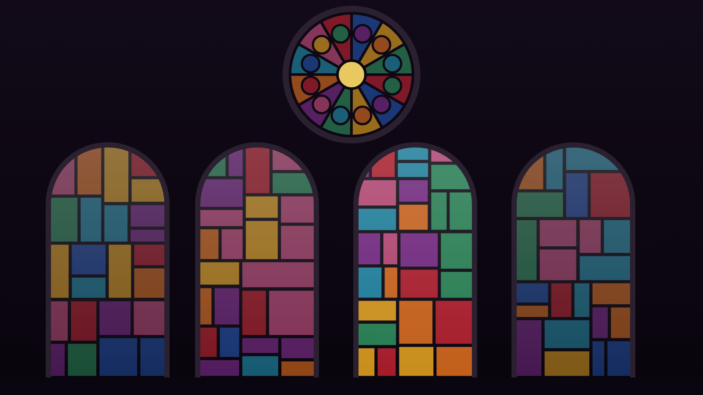

# Stained Glass

Four tall arched windows of ruby, sapphire, amber and emerald panes stand in dark lead under a rose window that turns very slowly. Light drifts across the glass and the panes brighten and dim in turn. Heavy glass keeps the middle readable.

It is a dark theme and keeps the app dark. The panels are frosted over the scene so text stays readable. Animations stop if your system asks for reduced motion.

Install: `/plugin install stained-glass --marketplace PerspicaciousGuy/ClaudeCodeThemes` (see the [repository README](../../README.md#install) for the desktop app and shell steps).
