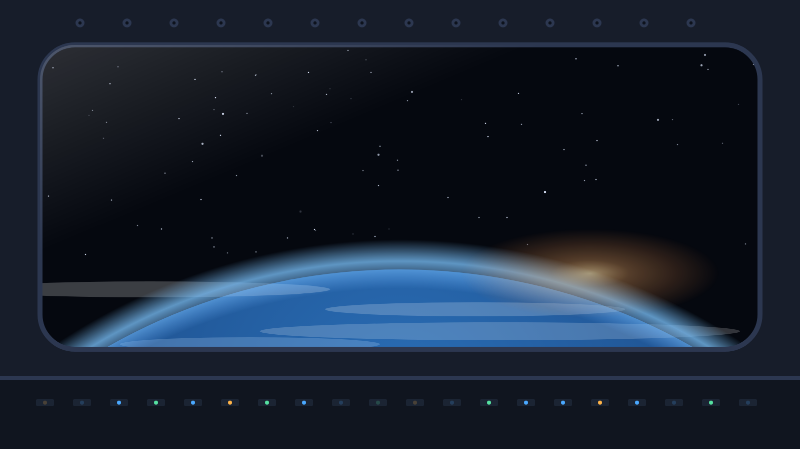

# Station Window

The view from a space station window. A bolted metal frame holds a pane of glass over the curve of the Earth with an atmosphere rim, bands of cloud drifting across it and a sunrise brightening the limb. Stars twinkle above, a satellite crosses slowly, and a console strip below blinks its indicator lights.

It is a dark theme and keeps the app dark. The panels are frosted over the scene so text stays readable. Animations stop if your system asks for reduced motion.

Install: `/plugin install station-window --marketplace PerspicaciousGuy/ClaudeCodeThemes` (see the [repository README](../../README.md#install) for the desktop app and shell steps).
