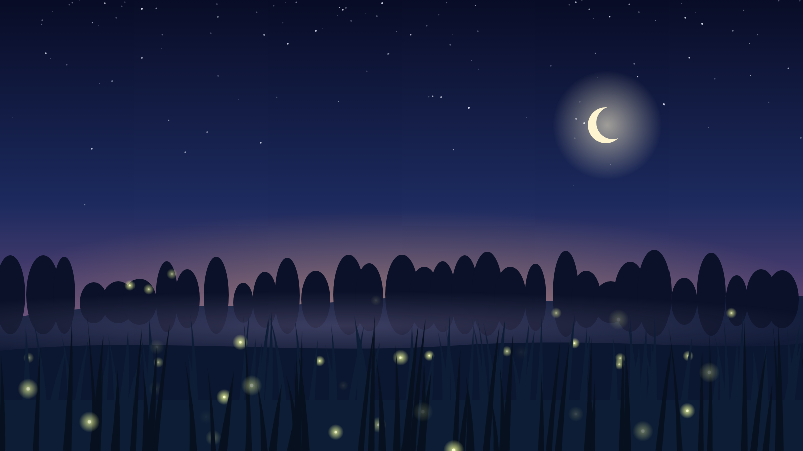

# Summer Fireflies

A summer meadow at dusk. Fireflies blink and wander over tall swaying grass, a thin moon hangs low, stars come out and the last orange glow fades on the horizon. The grass stays low so the middle is open for the chat.

It is a dark theme and keeps the app dark. The panels are frosted over the scene so text stays readable. Animations stop if your system asks for reduced motion.

Install: `/plugin install summer-fireflies --marketplace PerspicaciousGuy/ClaudeCodeThemes` (see the [repository README](../../README.md#install) for the desktop app and shell steps).
