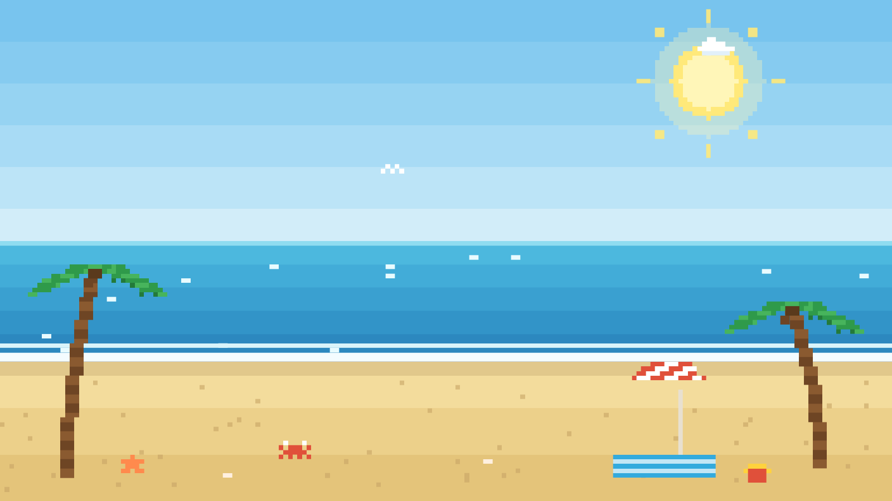

# Sunny Shore

A pixel-art beach on a bright day. The sun pulses, clouds drift, the sea sparkles around a small sailboat and foam rolls up the sand in two rows. Palms stand at both sides, an umbrella and a bucket sit at the right, gulls glide by and a crab scuttles along.

It is a light theme and keeps the app light. The panels are frosted over the scene so text stays readable. Animations stop if your system asks for reduced motion.

Install: `/plugin install sunny-shore --marketplace PerspicaciousGuy/ClaudeCodeThemes` (see the [repository README](../../README.md#install) for the desktop app and shell steps).
