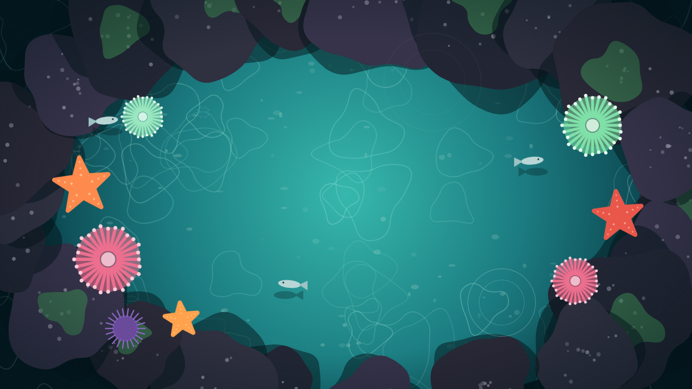

# Tide Pool

A look straight down into a rock pool. Dark rocks crusted with barnacles ring clear water; anemones breathe, starfish and a sea urchin rest at the sides, nets of light ripple over the bottom, drops make rings and small fish cross.

It is a dark theme and keeps the app dark. The panels are frosted over the scene so text stays readable. Animations stop if your system asks for reduced motion.

Install: `/plugin install tide-pool --marketplace PerspicaciousGuy/ClaudeCodeThemes` (see the [repository README](../../README.md#install) for the desktop app and shell steps).
