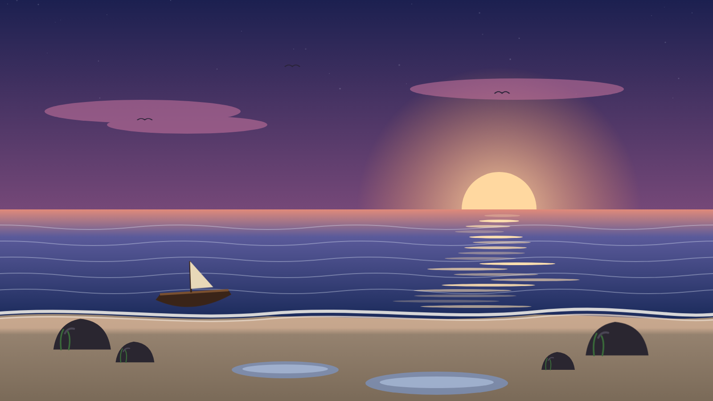

# Tide

A beach at dusk whose tide is your 5-hour limit.

- **The tide is your 5-hour limit.** High water means most of the window is left. As you use it the sea draws back and leaves wet sand, rocks, tide pools, shells and a starfish, and a boat that is afloat at high tide ends up aground. It follows the limit on a Claude subscription; with no limit reading it follows the context window.
- The sun sets over the water with its glints, gulls cross and clouds drift.

It is a dark theme and keeps the app dark. The panels are frosted over the scene so text stays readable. Animations stop if your system asks for reduced motion.

## Use it

Install: `/plugin install tide --marketplace PerspicaciousGuy/ClaudeCodeThemes` (see the [repository README](../../README.md#install) for the desktop app and shell steps).

Run `/tide` to put the look on. If you also use `theme-library` or another live theme, whichever theme was set last wins, so run `/tide` whenever you want this one back.

| Command | What it does |
| --- | --- |
| `/tide` or `/tide auto` | Apply the look and follow your real usage. |
| `/tide 0` to `/tide 5` | Hold a level to see it, until `/tide auto`. |

The reply to the command shows what it is reading, for example `tide: 88% of 5h left`.

## Why it is a separate plugin

Every other theme is a fixed scene, so they live together in `theme-library`. This one redraws as your session changes, so it is its own plugin and is not part of the library picker. The picture above is one moment of it.
