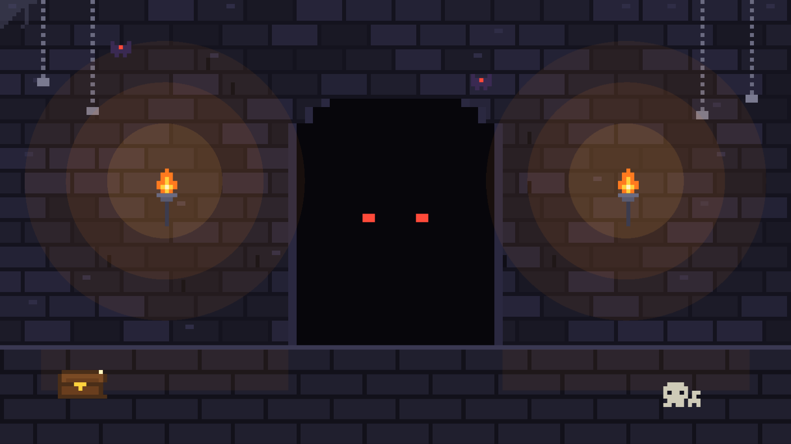

# Torch Dungeon

A pixel-art dungeon. A brick wall is lit by two flickering torches, a dark doorway in the middle watches with a pair of red eyes that blink, bats cross the ceiling, a slime hops along the flagstones and a chest glints at the left.

It is a dark theme and keeps the app dark. The panels are frosted over the scene so text stays readable. Animations stop if your system asks for reduced motion.

Install: `/plugin install torch-dungeon --marketplace PerspicaciousGuy/ClaudeCodeThemes` (see the [repository README](../../README.md#install) for the desktop app and shell steps).
