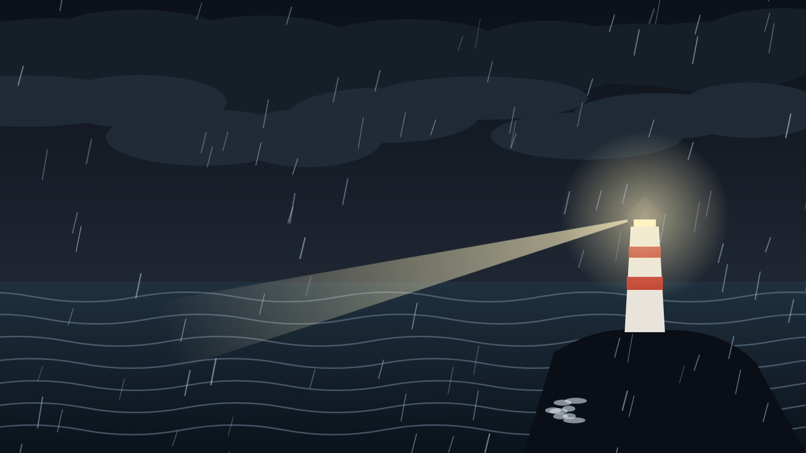

# Weather Mood

A lighthouse whose weather is Claude's mood.

- **Idle is clear and calm:** stars, a moon, a slow swell and a gentle lighthouse beam.
- **Working brings weather:** storm clouds roll in, rain slants down and the sea gets rougher. The rain is harder the fuller your context window is.
- **A failed tool call is a flash of lightning,** a bolt and two flashes, for a few seconds.

It is a dark theme and keeps the app dark. The panels are frosted over the scene so text stays readable. Animations stop if your system asks for reduced motion.

## Use it

Install: `/plugin install weather-mood --marketplace PerspicaciousGuy/ClaudeCodeThemes` (see the [repository README](../../README.md#install) for the desktop app and shell steps).

Run `/weather` to put the look on. If you also use `theme-library` or another live theme, whichever theme was set last wins, so run `/weather` whenever you want this one back.

| Command | What it does |
| --- | --- |
| `/weather` | Apply the look. |
| `/weather calm`, `rain`, `storm`, `flash` | Try a state. It changes again with the next turn. |

## Why it is a separate plugin

Every other theme is a fixed scene, so they live together in `theme-library`. This one redraws as your session changes, so it is its own plugin and is not part of the library picker. The picture above is one moment of it.
