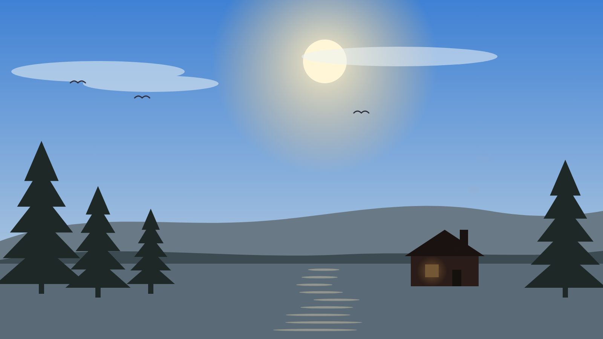

# Weekly Sky

A lakeside cabin under a sky that is your 7-day limit.

- **The sky is your weekly limit.** At the start of the week the sun is rising on the left. It climbs to noon at the middle of the week and sets as you near the limit. When you reach it, night falls, with stars and a moon over the lake.
- The cabin window warms as the light goes, smoke rises from the chimney and birds cross by day. The glass is heavier than usual because the sky is bright at midday. It needs a Claude subscription to read the 7-day limit; with none, the sun stays at sunrise.

It is a dark theme and keeps the app dark. The panels are frosted over the scene so text stays readable. Animations stop if your system asks for reduced motion.

## Use it

Install: `/plugin install weekly-sky --marketplace PerspicaciousGuy/ClaudeCodeThemes` (see the [repository README](../../README.md#install) for the desktop app and shell steps).

Run `/weeksky` to put the look on. If you also use `theme-library` or another live theme, whichever theme was set last wins, so run `/weeksky` whenever you want this one back.

| Command | What it does |
| --- | --- |
| `/weeksky` or `/weeksky auto` | Apply the look and follow your real 7-day usage. |
| `/weeksky 0` to `/weeksky 11` | Hold a time of day to see it, until `/weeksky auto`. |

The reply to the command shows what it is reading, for example `sky: 85% of the week used`.

## Why it is a separate plugin

Every other theme is a fixed scene, so they live together in `theme-library`. This one redraws as your session changes, so it is its own plugin and is not part of the library picker. The picture above is one moment of it.
