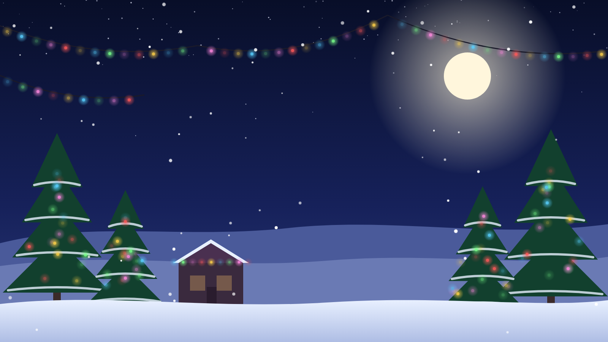

# Winter Lights

A snowy holiday night. Strings of colored lights sag across the sky and twinkle in three phases, fir trees and a cottage wear lights of their own, snow falls over soft drifts and a bright moon shines.

It is a dark theme and keeps the app dark. The panels are frosted over the scene so text stays readable. Animations stop if your system asks for reduced motion.

Install: `/plugin install winter-lights --marketplace PerspicaciousGuy/ClaudeCodeThemes` (see the [repository README](../../README.md#install) for the desktop app and shell steps).
