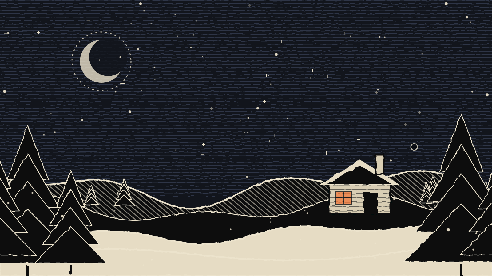

# Woodcut Cabin Night

The night twin of `woodcut-cabin`. The same print on night-blue stock: faint cut lines in the sky, a cream moon and a few stars, pines edged in cream, a log cabin whose one orange window glows, smoke curling up and snow falling in three layers.

It is a dark theme and keeps the app dark. The panels are frosted over the print so text stays readable. Animations stop if your system asks for reduced motion. Its twin is `woodcut-cabin`.

Install: `/plugin install woodcut-cabin-night --marketplace PerspicaciousGuy/ClaudeCodeThemes` (see the [repository README](../../README.md#install) for the desktop app and shell steps).
