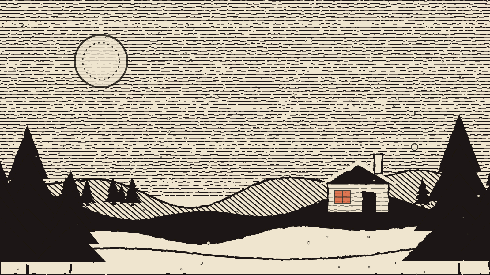

# Woodcut Cabin

A winter print in two inks. Cream paper and near-black ink, with one orange window: a sky of cut lines, hatched hills, solid black pines and a log cabin whose smoke curls up into the lines. Snow falls past in three layers, with an ink edge so each flake shows on the paper.

It is a light theme and keeps the app light. The panels are frosted over the print so text stays readable. Animations stop if your system asks for reduced motion.

Install: `/plugin install woodcut-cabin --marketplace PerspicaciousGuy/ClaudeCodeThemes` (see the [repository README](../../README.md#install) for the desktop app and shell steps).
