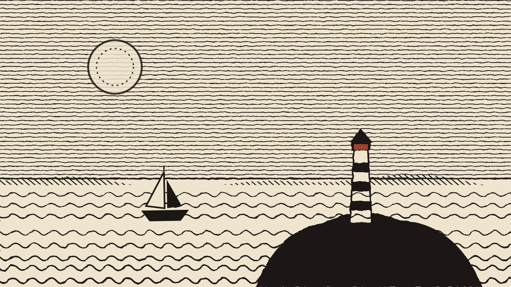

# Woodcut Harbor

A harbor printed in two inks on cream paper. Wavy cut lines make the sea and drift sideways, a black headland carries a striped lighthouse whose orange lamp pulses, a small sailboat rides the swell and gulls cross the sky.

It is a light theme and keeps the app light. The panels are frosted over the print so text stays readable. Animations stop if your system asks for reduced motion.

Install: `/plugin install woodcut-harbor --marketplace PerspicaciousGuy/ClaudeCodeThemes` (see the [repository README](../../README.md#install) for the desktop app and shell steps).
