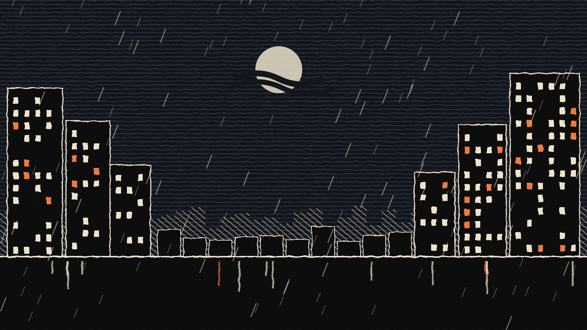

# Woodcut Rain City

A city at night in the rain, printed on dark stock. Tall black towers sit at the edges with cream and orange windows that flicker on and off, a moon hides behind hatched cloud, rain falls in streaks and the wet street below repeats the lights.

It is a dark theme and keeps the app dark. The panels are frosted over the print so text stays readable. Animations stop if your system asks for reduced motion.

Install: `/plugin install woodcut-rain-city --marketplace PerspicaciousGuy/ClaudeCodeThemes` (see the [repository README](../../README.md#install) for the desktop app and shell steps).
